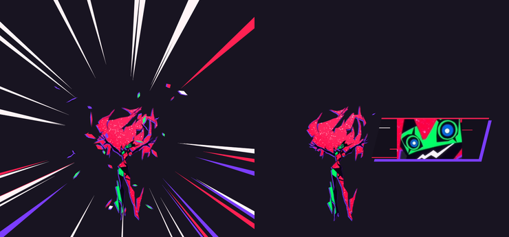
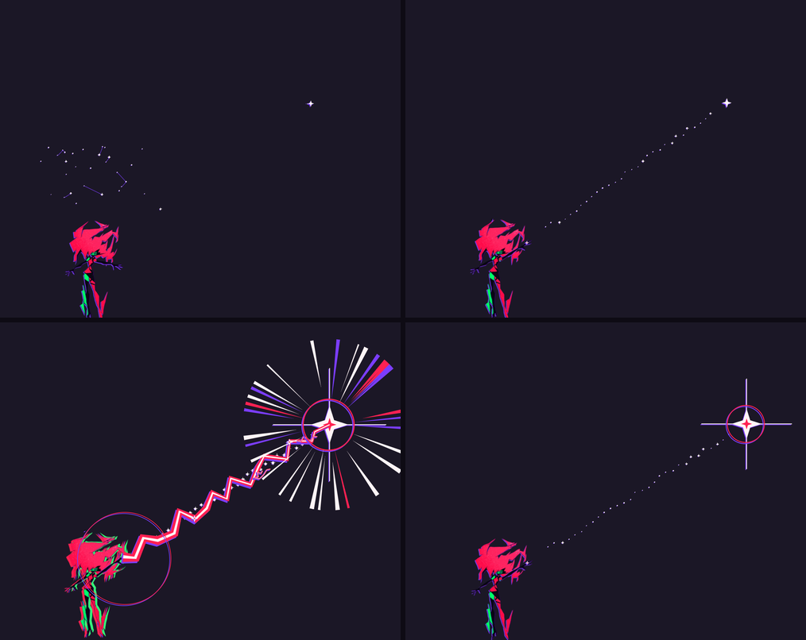
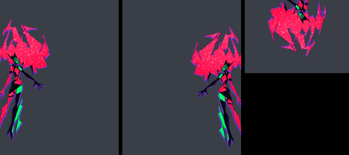
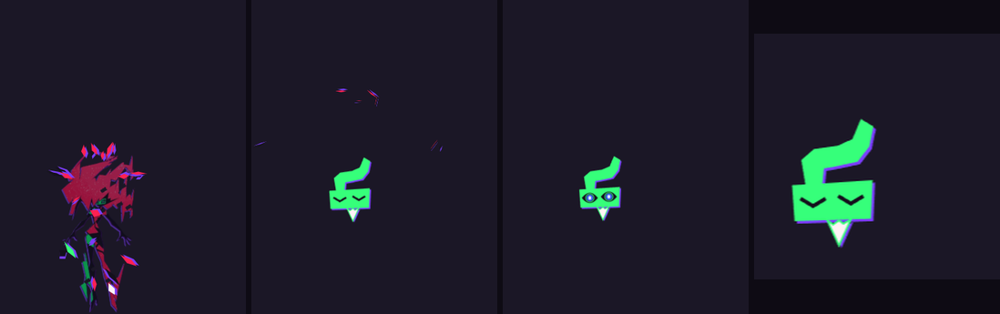
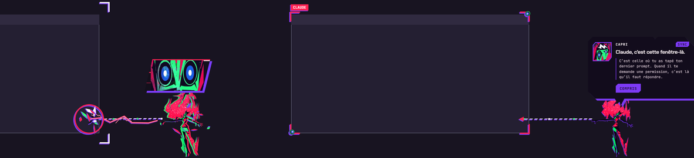
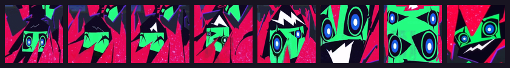

# Capri for macOS

Capri, the *Project Capricorn* construct from Cyberpunk: Edgerunners season 2, living on your Mac and telling you what
your coding AI is up to: **Claude Code**, **Codex** or **Antigravity**. She teleports, glitches, comments on every action,
comes to find you when it needs your permission, and loses it when the job is done.

This is an **unofficial macOS port** of [**Capri** by mochiiwuff](https://github.com/mochiiwuff/capri-desktop), which was
made for Windows. All the credit for Capri herself, her animation and her personality goes to the original project. This
port rebuilds everything that touched Windows so she works natively on a Mac. It's a free fan project: no payment, no
accounts, nothing to buy. If you enjoy her, a ⭐ on the repo is all I ask.

> **Disclaimer.** I don't own Capri, Cyberpunk, Cyberpunk: Edgerunners or any of their characters, art or names, nor any
> of the products mentioned here. This project isn't affiliated with or endorsed by CD PROJEKT RED, Studio Trigger,
> Netflix, Anthropic, OpenAI, Google, Apple, Spotify or Ollama. See [Credits and legal](#credits-and-legal).


## Install

You need a Mac with **macOS 12 or later**.

1. Download the `.dmg` from the [latest release](https://github.com/CyberMoonie/capri-macos/releases/latest):
   **`Capri-1.0.0-arm64.dmg`** for Apple silicon (M1 and later), **`Capri-1.0.0-x64.dmg`** for Intel Macs.
2. Open it and drag **Capri** to **Applications**.
3. Open Capri. The app isn't notarized by Apple (that costs a yearly fee), so macOS stops it the first time: go to
   **System Settings › Privacy & Security** and click **Open Anyway**. Or, in Terminal:
   `xattr -dr com.apple.quarantine /Applications/Capri.app`.
4. Capri shows up and introduces herself. Click **Plug me in** to connect her to Claude Code, then quit Claude Code
   completely and open it again. As soon as Claude does something, she tells you **"I can see Claude!"**.

Started from anywhere other than Applications (your Downloads, the disk image), she offers to move herself there first:
her hooks need her to stay where she is.

She lives in the **menu bar** (no Dock icon) and on your desktop. Her menu is on her menu-bar icon, or **right-click
her**.

> The Intel build is tested under Rosetta on Apple silicon, not yet on a real Intel Mac. If you run one, an issue saying
> how it went is very welcome.

### What macOS asks you, and when

Only when you use the feature that needs it:

| Permission | Asked when | For |
|---|---|---|
| **Screen & System Audio Recording** | "look at my screen", "take a screenshot" | the picture, and reading which AI is open in a window's title |
| **Accessibility** | "pause", "next"… in an app other than Spotify or Music (a browser) | pressing the media keys for you |
| **Automation** (per app) | the first time she controls Spotify, Music or your browser | playing and pausing, a song by its name, the address of your front tab (only to spot another AI) |
| **Files and Folders** | the first file search in Desktop, Documents or Downloads | finding your files |

If something isn't allowed, she tells you what, with a button to the right page of System Settings.

## What she does

- **When she starts**: she grabs your screen. Its edges crackle red, her hands slam onto them, she hauls herself up, her
  face hits the glass, she looks around, says hi, waves with her clawed hand, and dives down to her spot.

  

- **While Claude works**: a ticker over her head shows the current action (`EDITS gigs.ts`, `RUNS npm test`,
  `GREPS "paginate"`…) and she sheds little data glyphs. When Claude runs a command or goes on the web, red sparks fly
  off her fingers; sitting on a window, she jacks into it.
- **When Claude goes quiet mid-task** (thinking, or a slow local model): the ticker turns violet and counts the seconds.
- **When Claude needs you** (a permission, a question): she teleports next to your pointer. If you're on another window,
  she goes to Claude's window and points at it: that's where the question is.
- **When a command fails**: a red impact frame, she gets knocked back, and the error line that matters.
- **When it's done**: she teleports to the middle of your screen for her victory sequence, then the summary
  (`12 actions · 3 files changed · 2m 14s`) and Claude's last sentence.
- **When Claude answers and you're on another window**: she brings you its whole answer, in a panel that scrolls.
- **The rest of the time**: she floats, drifts from one corner to another, turns to your pointer (or zaps it), looks up
  at the satellite, and falls asleep after 10 quiet minutes, down to her green mask.





### On your Mac

- **She sits on your windows**, legs dangling. She rides along when you move the window and falls off when you close,
  minimize or cover it. Drop her on a window's top edge and she sits there; throw her and she flies, crashes into the
  edges of the screen, and lands on her feet (or doesn't).
- **She possesses your windows** now and then: red lightning round the frame, glitches, and the window looks at you with
  her eyes. Nothing is read from the window: it's only drawn over, for two seconds.
- **She follows you across desktops**: swipe to another desktop or a full-screen app and she stays on the one you left,
  then teleports in on the new one. She's never in Mission Control.
- **The Dock**: her menu › *When she rests* › **On the Dock, when it shows**. Hidden until you hover it? She waits in her
  corner, and stands on the Dock while it's up.
- **Several screens**: she follows your pointer to the screen you're on.
- **She feels your Mac**: the processor at full tilt, the charger, the battery, the network, a USB stick or SD card, a
  headset (AirPods included), a controller, your phone. A game in front (Steam, Epic, Mac App Store games): a word about
  it, then her menu › *During games* decides: **disappear until you stop playing** (nothing drawn at all) or **stay small
  in her corner**. When you stop, she asks if you won.
- **She gets attached**: the time you spend together brings you closer, over weeks, through five stages. And she gets
  **jealous** when you're on another AI (ChatGPT, Gemini, Claude, Copilot, Perplexity, DeepSeek, Grok, Le Chat,
  Character.AI, Meta AI), in its app or in your browser.







### She shows you around

**How does it work?** in her menu: she takes you to things and points at them, her arm shooting out with a reticle and a
wire of data: her menu-bar icon, Claude's window, Claude's folder (`~/.claude`, opened in Finder). **Plug me into
Claude** installs her hooks; **Free with Ollama** runs Claude Code or Codex through Ollama in a Terminal window.





### Talk to her

**Talk to her** in her menu: she answers in character, knows what Claude is doing, and speaks **French, English, Spanish,
Brazilian Portuguese and Russian**. The first time, she sets it up with you, with buttons:

- **On my Mac** (free, nothing leaves your Mac): she installs [Ollama](https://ollama.com) for you (its signed app from
  ollama.com), wakes it up and downloads a model. gemma3 can also look at your screen; bigger models (gemma3:12b,
  gemma3:27b) read it much better if your Mac has the memory.
- **Online, no account**: Pollinations.
- **I have a key**: Groq, Gemini, OpenRouter, OpenAI, Mistral or DeepSeek. The key is kept encrypted with a key from your
  Mac's keychain, and only sent to that service.
- Or LM Studio, llama.cpp, any OpenAI-compatible server, or **Claude Code** itself.

**What she can do on your Mac** when you ask in her chat:

- **Open an app or a game**: anything in Applications, your Steam and Epic games ("open Spotify", "launch Hades").
- **Your folders and your desktop**: "open my downloads", "open Finder", "open the Trash", or something on your desktop
  by its name. Anything that would run something (`.app`, `.command`, `.sh`, `.pkg`…) goes behind a button.
- **Find your files** with Spotlight, by name, by kind or by what's in them.
- **Music**: "pause", "play", "next", "louder"… With Spotify or Music she knows what's playing ("pause" twice stays
  paused). "Play Bohemian Rhapsody" plays that song, on YouTube or Spotify (her menu › *Music on*). "Play something of
  your choice": she picks, and it plays. "Play it": the song she just named.
- **Close an app**, behind a button, the way Cmd+Q does (it can still ask you to save); **Force quit** only on your click.
- **Reminders** ("remind me in 20 minutes to stretch"), **web searches**, **screenshots** (saved where your Mac saves
  them), **a Roblox game by its name**, a **website** behind a button.
- **Look at your screen**: the window in front, read and commented on, her way.

**It's AI.** Her replies are written by the model you pick, not by the show's writers. A small local model can get
things wrong (a song that doesn't exist, a vague look at your screen): a bigger one does much better.

### With the mouse and the keyboard

- **Click** her: where Claude is at (nothing going on: **Talk to me**). **Drag** her, **throw** her, **right-click** her
  for her menu.
- **⌃⌥C** (Control-Option-C): she puts herself away into her biochip, bottom left. Click the mask (or ⌃⌥C) to bring her
  back.

## Codex or Antigravity instead of Claude Code

Her menu › **Watch** › **Codex** or **Antigravity**, and she offers to plug herself in, like for Claude Code. Codex: its
hooks go in `~/.codex/hooks.json` (restart it and trust them). Antigravity: `~/.gemini/config/hooks.json`.

From the command line: `npm run hooks:install` (Claude Code), `npm run hooks:codex:install`,
`npm run hooks:agy:install`, and `:uninstall` to remove them. Her hooks keep your other hooks, write a backup first,
never slow your assistant down, and do nothing when Capri isn't running.

## What leaves your Mac

Nothing, unless you pick an online AI for her chat.

- Her hooks send what the display needs (tool names, file paths, commands, the start of your prompt, Claude's last
  message) to `127.0.0.1` only. File contents are never sent.
- Window titles and your browser's front-tab address are only checked on your Mac against a list of AI names and sites,
  for her jealousy. They're never kept or sent anywhere.
- Looking at your screen sends a picture of the window in front to her chat's AI: on your Mac with Ollama, to the online
  service otherwise. It's never written to disk.
- Asked to play a song by its name on Spotify, she looks it up with a web search (DuckDuckGo, else Brave) and checks
  its title with Spotify.

## Build it yourself

You need [Node.js](https://nodejs.org) 20 or newer and Apple's command line tools (`xcode-select --install`).

```bash
git clone https://github.com/CyberMoonie/capri-macos.git
cd capri-macos
npm install
npm start          # her native helper is built from Swift the first time
npm test           # her tests
npm run dist       # the .dmg and .zip for Apple silicon and Intel, in dist/
```

Run from a terminal, the permissions macOS asks for go to that terminal app, not to Capri. `npm run dev` adds debug
routes on her local bridge (`/debug/capture`, `/debug/testwin`, `/debug/mouse`, `/debug/menu`…).

```
hooks/                     run by your coding assistant: the event, trimmed, posted to her on 127.0.0.1
scripts/                   installing her hooks, building her helper
src/main/
  main.js                  the overlay, her menu, following you across desktops, the bridge to her renderer
  mac/capri-helper.swift   her eyes: windows, the Dock, desktops, devices, apps, media keys
  mac.js / windows.js      running that helper, the PATH from Finder, the windows as she sees them
  launch.js / apps.js      opening and closing apps, music, Spotify, YouTube, Roblox, websites
  files.js / setup.js      Spotlight, screenshots; Ollama and her AI's setup
src/renderer/js/
  sprite.js / acting.js    her WebGL drawing and her exposure sheets, frame by frame
  capri.js / fx.js         the character and her effects
  brain.js / chat.js       Claude's events turned into lines; talking to her
  lines.js                 what she says, in five languages
```

## FAQ

- **She barely moves.** macOS has *Reduce motion* on and she follows it: her menu › **Animations** › **Full**.
- **She never reacts to Claude Code.** Check her menu says *Claude Code hooks: installed*, then quit Claude Code
  completely and open it again.
- **"Look at my screen" is vague.** That's the model: small local models guess a lot from pictures. Try gemma3:12b or
  an online model in her menu › **AI model**.
- **Can I turn her off?** ⌃⌥C puts her away, **Quit** in her menu closes her. To uninstall, drag Capri from
  Applications to the Trash (and her hooks out first: her menu › *Remove Claude Code hooks*).
- **Windows?** Use the original: [mochiiwuff/capri-desktop](https://github.com/mochiiwuff/capri-desktop).

## Credits and legal

- **Capri** was created by **mochiiwuff** as [capri-desktop](https://github.com/mochiiwuff/capri-desktop), for Windows:
  her character work, animation, art direction, lines and features are theirs. This repository is an unofficial macOS
  port of it, made by **CyberMoonie**, with the original's full history kept.
- **License: free, never for sale.** The code is under the [PolyForm Noncommercial License 1.0.0](LICENSE), as the
  original is: you can use it, change it and share what you made, for free. Selling it, or anything made from it (keys,
  subscriptions, paid access, paid orders), is not allowed.
  `Required Notice: Copyright (c) 2026 mochiiwuff (https://github.com/mochiiwuff/capri-desktop)`
- **The character and her images.** Capri / Project Capricorn, Cyberpunk and Cyberpunk: Edgerunners belong to
  CD PROJEKT RED, Studio Trigger and Netflix. The images in `assets/capri/` come from frames of the show, a fan-made
  cut-out and fan art; they are **not** covered by the code's license, and neither I nor the original project claims
  any ownership of them. If a rights holder wants them removed, open an issue and they'll go.
- **Everything else named here** (Claude Code, Codex, Antigravity, ChatGPT, Gemini, Spotify, Ollama, macOS, Steam, Epic
  Games, Roblox…) belongs to its owners. This project has no affiliation with any of them; their names are only used to
  say what Capri works with.
- **Fonts**: Chakra Petch and JetBrains Mono, under the SIL Open Font License, via Fontsource.
- **No warranty.** It's provided as is, as the license says.

If Capri made your desk a little more alive, a ⭐ helps others find her. Thank you.
